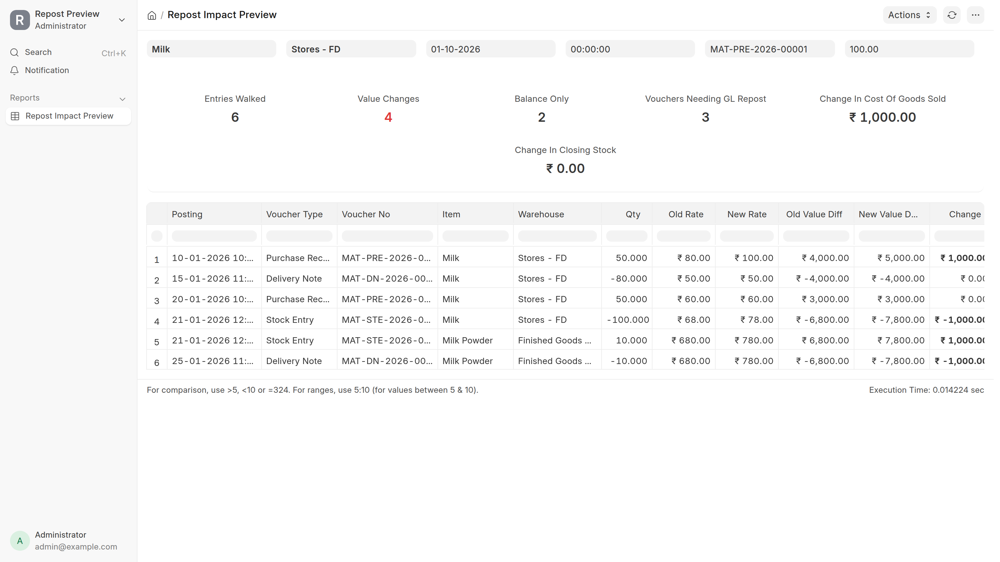
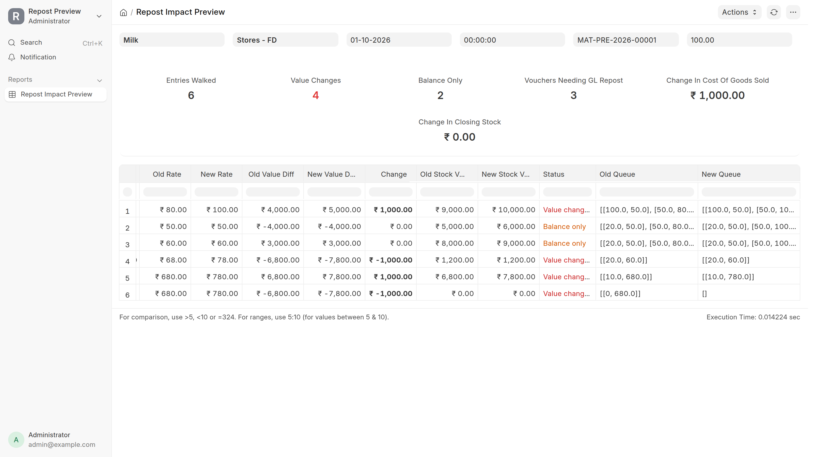

# Repost Preview

A dry run for stock reposting in ERPNext, for FIFO items.

When a backdated entry comes in or the rate on an old purchase receipt changes, ERPNext queues a Repost Item Valuation. That job rewrites every later stock ledger entry for that item and warehouse, and for anything manufactured from it. Till the job finishes nobody knows what it is going to change. This app shows the impact first, without writing anything.



This is the demo site after the 10 Jan receipt was already corrected from 60rs to 80rs, previewing what 100rs would do. Same shape as the 60 to 80 case below: the 15 Jan delivery keeps its cost, the manufacture entry and the powder move, 1000rs goes to cost of goods sold, closing stock stays.

<details>
<summary>Status and queue columns</summary>



</details>

## Using it

Stock > Repost Impact Preview.

Pick an Item, a Warehouse and a From Date. If you also pick a Purchase Receipt and a New Rate, the report starts at that receipt and treats its rows as if they came in at the new rate. It walks the ledger from there in memory and lists every entry with old and new values next to each other.

Three statuses on the rows.

Value changes means the entry's own cost moved and its GL entry would get reposted. Balance only means the cost is same but the running stock value and the FIFO queue saved on that row change. Unchanged is unchanged.

On top there is a summary: entries walked, vouchers that would need a GL repost, change in cost of goods sold and change in closing stock. Those two amounts should always add up to the change you made on the receipt.

## Example

This is the case i built it for. Milk is FIFO. Opening 100 L at 50rs. Receipt of 50 L at 60rs on 10 Jan. Delivery of 80 L on 15 Jan. Receipt of 50 L at 60rs on 20 Jan. On 21 Jan 100 L milk is manufactured into 10 kg milk powder. On 25 Jan the 10 kg powder is delivered. Now preview the 10 Jan receipt at 80rs.

| Entry | Old value diff | New value diff | Status |
|---|---|---|---|
| 10 Jan receipt | 3000 | 4000 | Value changes |
| 15 Jan delivery 80 L | -4000 | -4000 | Balance only |
| 20 Jan receipt | 3000 | 3000 | Balance only |
| 21 Jan manufacture, milk | -5800 | -6800 | Value changes |
| 21 Jan manufacture, powder | 5800 | 6800 | Value changes |
| 25 Jan delivery powder | -5800 | -6800 | Value changes |

The 15 Jan delivery took the opening milk at 50rs, so its cost does not move. The manufacture entry is the first one to use the 80rs milk, so the change goes into the powder and then into the powder delivery. Change in cost of goods sold 1000rs, change in closing stock 0.

## How it works

Everything is in `repost_preview/simulation.py`. The report file is just columns and the summary.

1. Find the last entry before the chosen date and take the FIFO queue stored on it.
2. Walk every later entry for that item and warehouse, ordered by posting datetime and then creation.
3. Redo the queue on each entry using erpnext's own `FIFOValuation` / `LIFOValuation`. Where a new rate is given, use that.
4. If an entry's value changed and it points at another entry through `dependant_sle_voucher_detail_no`, give that entry its new rate and add that item and warehouse into the same sorted walk. For a transfer, the receiving warehouse gets exactly what left the sending one. For a manufacture, the finished good takes the change in the raw material's cost.
5. Compare each entry with what is saved on it and report.

## Scope

FIFO and LIFO, plain items. No serial or batch bundles. No Moving Average. One anchor item and warehouse per run, so a finished good made from two raw materials that both changed needs two runs.

## Install

```
bench get-app https://github.com/rakshitGitHubb/repost_preview
bench --site <site> install-app repost_preview
```

Needs erpnext.

## Tests

```
bench --site <test site> run-tests --app repost_preview
```

Four tests in `test_repost_impact_preview.py`.

`test_rate_change_on_receipt_shows_only_rows_that_used_that_layer` builds the milk case above with erpnext's own test helpers, previews the receipt at 80rs and checks every row: the delivery is balance only, the manufacture goes to 6800, the powder rate becomes 680, the powder delivery changes, closing milk stays 1200.

`test_preview_does_not_write_anything` reads the powder delivery's value from the DB, runs the preview, reads it again. Same number both times.

`test_walk_without_a_change_reports_everything_unchanged` runs the preview with no new rate. Four rows, all unchanged, and the walk never enters the powder because nothing on milk moved.

`test_transfer_passes_the_new_rate_to_the_other_warehouse` buys 10 at 60rs, transfers them to another warehouse, delivers from there, then previews the receipt at 80rs. The transfer's incoming side comes out at 80rs and the delivery from the other warehouse changes too.

## Approach and design decisions

The question i was answering is "if this receipt rate changes, what exactly happens to the ledger". Replaying is the only honest way to answer it for FIFO. Layers merge when the rate is same and split when it is different, so the queue changes shape and you cannot spread a difference over later rows with arithmetic. So the app replays, the same walk erpnext does inside `update_entries_after`.

A few decisions i made on the way.

I reused erpnext's queue class instead of writing my own. If the preview and the real repost ever disagree on the queue maths, the preview is wrong, and the easiest way to never be wrong is to use the same code.

I follow a dependant row only when the consumed row's value actually changed. If the milk row did not move, nothing made from it can move, and skipping it keeps the walk small.

It is read only on purpose. No locks, no background job, no commits. That is fine for a preview. The real repost needs all three, which is why it lives in a separate job with a resume cursor and progress counters.

The summary shows change in cost of goods sold and change in closing stock separately because that is how an accountant checks the result. The extra cost either went out in a sale or it is still sitting in stock, and the two together must equal the change on the receipt.

## License

MIT. See license.txt.
